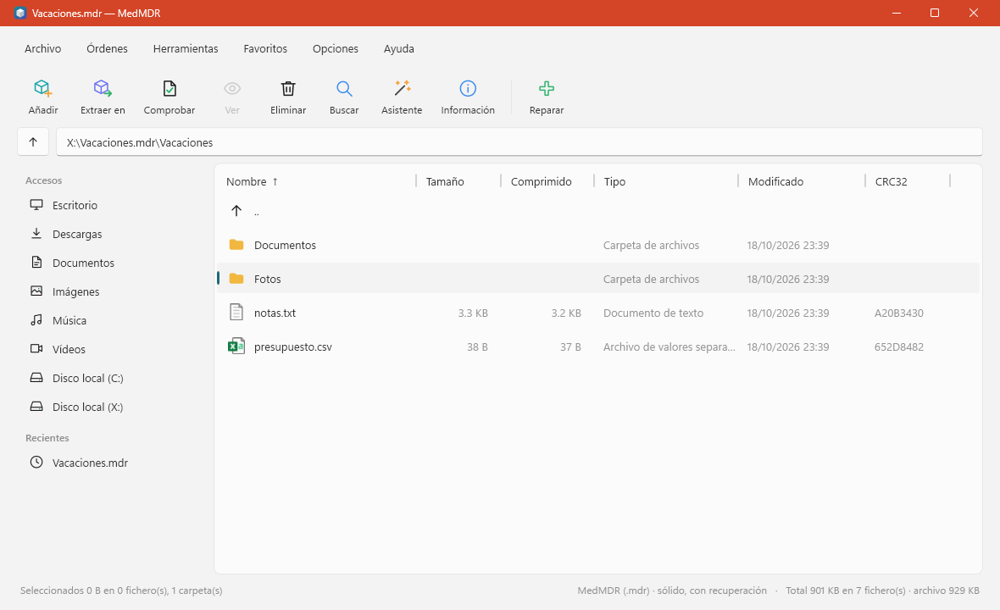
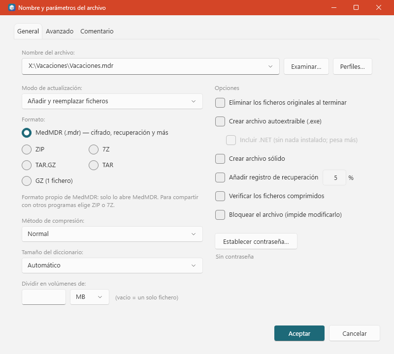

# Medrar

Gestor de archivos comprimidos para Windows, escrito desde cero en C# (.NET 10, Windows Forms).
**Crea** archivos **.mdr** (formato propio), **ZIP** y **7Z** (ambos también con contraseña AES-256), **TAR**, **TAR.GZ** y **GZ**,
y **abre** además RAR (también con contraseña), BZ2, XZ, LZ, CAB, ISO y otros.

> Medrar es una versión propia inspirada en las funciones de un gestor clásico de archivos comprimidos.
> No contiene código, imágenes, iconos ni textos de ningún otro programa: todo está escrito y dibujado aquí.



## Descargar e instalar

Ve a **Releases** (a la derecha en GitHub) y baja **`Medrar-<versión>-x64.msi`**: es el instalador de Windows.

1. Haz doble clic y sigue el asistente (está en español). Se instala **solo para tu usuario**, en
   `%LocalAppData%\Programs\Medrar`, y **no pide permisos de administrador**.
2. En la lista de componentes puedes elegir si asociar los archivos `.mdr`, añadir «Añadir a un archivo con Medrar» al menú del
   botón derecho y crear un acceso directo en el escritorio.
3. Hace falta el [**.NET 10 Desktop Runtime**](https://dotnet.microsoft.com/download/dotnet/10.0) (x64): si falta, el instalador lo
   dice y no continúa.
4. **Se actualiza solo** (ver abajo). También puedes ejecutar el `.msi` de una versión nueva encima: la sustituye y conserva tu
   configuración.
5. Para **desinstalar**: Configuración de Windows → Aplicaciones → Medrar. Tu configuración (`%APPDATA%\Medrar`) no se borra.

> El instalador **no está firmado digitalmente**, así que Windows SmartScreen puede mostrar «Windows protegió su PC»:
> pulsa *Más información → Ejecutar de todos modos*. (Firmar exige un certificado de pago.)
> El repositorio es privado: para descargar hay que iniciar sesión en GitHub con la cuenta que tiene acceso.
>
> **Si tenías Medrar 1.1.x instalado con el antiguo instalador `.exe`** (Medrar-Setup-….exe), desinstálalo antes
> (Configuración de Windows → Aplicaciones → Medrar). El `.msi` nuevo lo detecta y se niega a instalarse encima, porque las
> asociaciones de archivos de la versión antigua anularían las nuevas. Tus archivos y tu configuración no se tocan.

**Sin instalar (portable):** la release también trae `Medrar-<versión>-win-x64.zip`; descomprímelo y abre `Medrar.exe`.
La copia portable avisa de las versiones nuevas, pero no se instala sola (solo la del `.msi` puede hacerlo).

### Actualización automática

- Al abrir Medrar (como mucho **una vez cada 24 horas**) y desde **Ayuda → Buscar actualizaciones…**, Medrar pregunta a GitHub
  cuál es la última versión publicada. Si hay una nueva, muestra sus novedades y te deja **Actualizar**, **Más tarde** u
  **Omitir esta versión**. Se puede desactivar en *Configuración → Actualizaciones*.
- Al aceptar, descarga el `.msi`, **comprueba su suma SHA-256** con la que la release publica en `SHA256SUMS.txt` (si no
  coincide, o la release no trae las sumas, **no instala nada**), cierra Medrar, instala la versión nueva encima (con una
  barra de progreso de Windows) y vuelve a abrir Medrar.
- **El repositorio es privado**, así que GitHub no deja ver las versiones sin identificarse. Hay que crear una vez un
  **token de acceso de solo lectura** (GitHub → Settings → Developer settings → *Fine-grained tokens*, solo para el
  repositorio `Medrar`, permiso **Contents: Read-only**) y pegarlo en *Configuración → Actualizaciones*. Se guarda **cifrado con
  tu cuenta de Windows (DPAPI)** y solo se envía a `api.github.com`. Sin token, la búsqueda falla con un mensaje claro y no
  molesta al abrir el programa. Si algún día el repositorio pasa a ser público, no hace falta token.
- Al actualizarse, el instalador vuelve a aplicar los componentes por defecto: si habías quitado la asociación `.mdr` o el menú
  del botón derecho, vuelven a aparecer (se quitan en *Configuración → Integración*); el acceso directo del escritorio solo si lo
  habías marcado.

| Fichero | Para qué sirve |
|---|---|
| `Medrar.exe` | La aplicación de escritorio. Haz doble clic. |
| `mdr.exe` | La misma funcionalidad en línea de comandos. |
| `Medrar.Sfx.exe` | Módulo para crear archivos autoextraíbles ligeros. Debe estar junto a `Medrar.exe`. |
| `Medrar.Sfx.Full.exe` | Módulo para autoextraíbles que incluyen .NET (funcionan en cualquier Windows; pesan ~50 MB más). Junto a `Medrar.exe`. |

## Cómo se usa

**Explorar.** La ventana es un explorador de archivos. Doble clic en una carpeta para entrar; doble clic en un archivo
comprimido para abrirlo como si fuera una carpeta. `Retroceso` sube un nivel. Puedes escribir una ruta en la barra de direcciones.

**Crear un archivo.**
1. Selecciona ficheros o carpetas (o arrástralos a la ventana).
2. Pulsa **Añadir** (`Alt+A`).
3. Elige nombre, formato y opciones → **Aceptar**.



**Extraer.** Abre o selecciona el archivo y pulsa **Extraer en** (`Alt+E`). `Alt+W` extrae sin hacer preguntas.
También puedes **arrastrar ficheros desde dentro del archivo** a una carpeta del Explorador.

**Contraseña.** En «Añadir» → *Establecer contraseña*. Vale para **.mdr**, **ZIP** y **7Z** (AES-256; ZIP y 7Z los abren 7-Zip, WinRAR y demás).
En .mdr y 7Z puedes marcar «Cifrar también los nombres» para que ni siquiera se vea la lista de ficheros; el ZIP no puede ocultar
los nombres. Medrar **no guarda contraseñas**. Al abrir un archivo cifrado, Medrar pide la contraseña y comprueba que sea correcta.

**Proteger y reparar.** «Registro de recuperación» añade datos de paridad (códigos Reed-Solomon) para reparar un archivo dañado
(*Herramientas → Reparar archivo*). En .mdr va dentro; en ZIP, 7Z, TAR… va en un fichero aparte `nombre.ext.mdrrec`
(guárdalo junto al archivo). La reparación crea una **copia** y no toca el original. Se pueden reparar varios bloques dañados
(con 5 %: unos 10 bloques de 16 KB por cada ~200), también seguidos, y con el fichero `.mdrrec` incluso un archivo **truncado**.

**Bloquear.** *Órdenes → Bloquear / desbloquear*: impide modificar el archivo desde Medrar (en .mdr con una marca interna;
en los demás formatos con el atributo de solo lectura del fichero).

**Volúmenes.** «Dividir en volúmenes» parte el archivo en `.001`, `.002`… Abre el `.001` y Medrar los une solo.

**Autoextraíbles.** «Crear archivo autoextraíble» genera un `.exe` que se abre con doble clic, para **cualquier formato**.
La versión ligera necesita .NET 10 en el equipo de destino; marcando «Incluir .NET» funciona en cualquier Windows (pesa ~50 MB más).
Un autoextraíble es de solo lectura en Medrar; *Herramientas → Quitar el módulo autoextraíble* devuelve el archivo original.

### Atajos de teclado

| Atajo | Acción | Atajo | Acción |
|---|---|---|---|
| `Alt+A` | Añadir | `Alt+I` | Información del archivo |
| `Alt+E` | Extraer en… | `Alt+R` | Reparar |
| `Alt+T` | Comprobar | `Alt+Q` | Convertir archivos |
| `Alt+V` | Ver fichero | `Alt+X` | Convertir en autoextraíble |
| `Supr` | Eliminar | `Alt+P` | Proteger contra daños |
| `F2` | Renombrar | `Alt+L` | Bloquear / desbloquear |
| `F3` | Buscar | `Ctrl+O` | Abrir archivo |
| `Ctrl+S` | Configuración | `F1` | Ayuda |

### Todas las funciones

- **Órdenes:** añadir, extraer, comprobar, ver (texto, hexadecimal e imágenes), eliminar, renombrar, comentario, proteger, bloquear.
- **Herramientas:** asistente paso a paso, convertir entre formatos, reparar, autoextraíbles, buscar texto o bytes
  (en carpetas y dentro de archivos), información, informe (HTML/TXT), prueba de velocidad.
- **Favoritos**, historial, archivos recientes, perfiles de compresión, importar/exportar configuración.
- **Temas** claro/oscuro/sistema, arrastrar y soltar (dentro y fuera), menú contextual.
- **Integración con Windows** opcional (Configuración → Integración): asociar `.mdr` y menú del botón derecho.
  Solo escribe en tu usuario (HKCU) y se quita con un clic.

### Línea de comandos

```
mdr a -m4 -s -rr5 -hpMiClave datos.mdr carpeta\      crear .mdr (nivel 4, sólido, recuperación 5 %, contraseña y nombres cifrados)
mdr a -fzip -pMiClave datos.zip carpeta\             ZIP con contraseña AES-256
mdr a -f7z -hpMiClave datos.7z carpeta\              7Z con contraseña y nombres cifrados
mdr a -sfxfull -fzip datos carpeta\                  autoextraíble que incluye .NET
mdr x -pMiClave -ocarpeta datos.mdr                  extraer
mdr l datos.mdr     mdr t datos.mdr     mdr i datos.mdr     listar / comprobar / información
mdr d datos.mdr "*.tmp"      mdr c viejo.rar nuevo.mdr      eliminar / convertir
mdr r datos.zip             mdr s datos.7z                  reparar / hacer autoextraíble
mdr -h                                                      ayuda completa
```

## Límites (leer antes de confiar en Medrar)

- **No crea .rar.** El formato RAR es propietario y su licencia no permite reimplementar su compresor. Medrar los **abre y extrae**
  (incluidos sólidos y con contraseña) y los **convierte** a .mdr, ZIP o 7Z. Para compartir, usa ZIP o 7Z.
- **.mdr es un formato propio:** solo lo abren Medrar y su módulo autoextraíble. Está **documentado** en
  [`docs/FORMATO-MDR.md`](docs/FORMATO-MDR.md) para que otros puedan leerlo, pero ningún otro programa lo abre hoy.
- **7Z con contraseña:** el cifrado de 7-Zip (AES-256-CBC) **no autentica** los datos: una clave mala o un archivo dañado se notan por
  la suma de control o porque falla la descompresión, pero no hay una firma como en .mdr o ZIP. Los 7Z con contraseña se crean
  siempre «sólidos» (un único bloque).
- **ZIP con contraseña: los nombres de los ficheros no se cifran** (limitación del formato ZIP). Solo se cifra el contenido.
  En .mdr sí se pueden cifrar los nombres.
- **El bloqueo es una protección contra accidentes, no seguridad:** se deshace desde Medrar o quitando «solo lectura».
- **Recuperación:** repara hasta el porcentaje elegido por grupo de bloques; si el daño es mayor, lo dice y no inventa datos.
  Un **.mdr con el registro dentro** no se puede reparar si pierde el final (ahí está el registro): para ese caso usa un ZIP/7Z con
  su fichero `.mdrrec`, que sí sirve para archivos truncados. Si borras o pierdes el `.mdrrec`, no hay reparación.
- **Autoextraíbles:** el ligero necesita .NET 10; el «completo» no necesita nada pero pesa ~50 MB. No admiten volúmenes.
  Un autoextraíble no lo pueden abrir otros programas como si fuera un archivo normal (sí Medrar).
- **Arrastrar fuera:** con poco contenido (hasta ~64 MB) es inmediato. Con más, Medrar extrae primero (con progreso) y hay
  que volver a arrastrar la selección.
- En modo sólido, el «tamaño comprimido» por fichero es una **estimación proporcional**.
- Editar un archivo (añadir, eliminar, renombrar) lo **reescribe entero** en un temporal y lo sustituye al terminar; con
  archivos grandes necesita espacio libre en disco. RAR y autoextraíbles son de solo lectura.
- **RAR con contraseña:** se abren los de cabeceras cifradas (Medrar pide la clave al abrir) y los de solo contenido cifrado
  (se ve el listado y se pide la clave al extraer). En RAR cifrados no se puede comparar la suma de control normal, así que un
  error solo se detecta si falla el descifrado o la descompresión. Probado con RAR 5 creados por WinRAR 7.23; RAR 4 cifrados, no.
- **Actualizaciones:** solo la copia instalada con el `.msi` se actualiza sola. El `.msi` no está firmado, así que la garantía de que
  es el correcto es la suma SHA-256 publicada en la misma release de GitHub: protege de descargas dañadas o alteradas por el camino,
  pero **no** de alguien que controle el propio repositorio. Mientras el repositorio sea privado hace falta el token de solo lectura.
  La actualización se probó con el código real contra un servidor GitHub falso local y con el instalador real (esperar a que se
  cierre Medrar, instalar encima y reabrir); los cuadros de aviso y de progreso no se probaron manualmente en la ventana.
- **Qué se probó a mano en la ventana real:** abrir, ver, comprobar y extraer con **.mdr, ZIP con contraseña y RAR con contraseña**;
  crear **.mdr** y **ZIP con contraseña**; editar (eliminar o renombrar) en **.mdr, ZIP con y sin contraseña, 7Z y TAR.GZ**;
  proteger, reparar un ZIP dañado y arrastrar fuera del archivo. Los autoextraíbles se probaron ejecutándolos (ligero y completo,
  con ZIP, 7Z, .mdr y contraseña). Crear 7Z, TAR.GZ y autoextraíbles se hizo con la línea de comandos y las pruebas automáticas
  (el 7Z, el 7Z con contraseña y el ZIP con contraseña además se abrieron con WinRAR), no desde el diálogo de la ventana.

## Qué guarda y qué envía

- Guarda su configuración en `%APPDATA%\Medrar\settings.json` (tema, favoritos, perfiles, carpetas recientes). **Nunca contraseñas.**
- Los errores inesperados se anotan en `%APPDATA%\Medrar\error.log`.
- **La única conexión a Internet es la búsqueda de actualizaciones** (a `api.github.com` y a la descarga de la release). No envía
  ningún dato tuyo ni de tus archivos, no hay telemetría, y se puede desactivar en *Configuración → Actualizaciones*.
- El token de GitHub de las actualizaciones, si lo pones, se guarda **cifrado con DPAPI** en `settings.json` (solo lo descifra tu
  cuenta de Windows en este equipo).
- Al abrir un fichero del archivo con doble clic o arrastrarlo, se extrae a `%TEMP%\Medrar\` y se borra al cerrar Medrar.

## Seguridad

- **.mdr:** AES-256-GCM por bloques de 64 KB (cada bloque se autentica) con clave derivada por PBKDF2-HMAC-SHA256, 200 000
  iteraciones y sal aleatoria de 16 bytes.
- **7Z:** AES-256-CBC de 7-Zip (clave por SHA-256 repetido 2^19 veces con sal aleatoria; IV aleatorio), con cabecera cifrada
  opcional para ocultar los nombres.
- **ZIP:** cifrado AES-256 de WinZip (AE-2: clave por PBKDF2-HMAC-SHA1 con 1 000 iteraciones, **fijadas por el formato**, y
  firma HMAC-SHA1 de cada fichero). Medrar **verifica la firma** al leer, así que un ZIP manipulado se detecta. Es más débil
  frente a ataques de fuerza bruta que .mdr por esas pocas iteraciones: usa contraseñas largas.
- Al extraer, las rutas se limpian: `..`, rutas absolutas, nombres reservados de Windows y caracteres no válidos se neutralizan
  (protección contra «zip slip»). Los enlaces simbólicos no se siguen al comprimir.
- Cada fichero lleva su suma de control y se verifica al extraer y al comprobar.

## Cómo está hecho

```
src/Medrar.Core     Motor (sin interfaz): formatos, cifrado, recuperación, volúmenes, autoextraíbles, búsqueda...
src/Medrar          La aplicación de escritorio (Windows Forms, todos los iconos dibujados por código)
src/Medrar.Cli      mdr.exe, línea de comandos
src/Medrar.Sfx      Módulo autoextraíble
installer/          Instalador MSI (WiX Toolset 6)
tests/Medrar.Tests  127 pruebas automáticas del motor y del actualizador
docs/FORMATO-MDR.md Especificación del formato .mdr
```

### Compilar y probar

Requisitos: [.NET SDK 10](https://dotnet.microsoft.com/download). Para el instalador, `build.ps1` descarga solo
[WiX Toolset 6](https://wixtoolset.org) en `.tools\` (se elige la 6.x a propósito: la 7 exige aceptar una cuota de mantenimiento OSMF).

```
powershell -ExecutionPolicy Bypass -File build.ps1            compila y deja todo en dist\Medrar
powershell -ExecutionPolicy Bypass -File build.ps1 -Test -Zip -Installer   pruebas + .zip + .msi + SHA256SUMS.txt (en dist\)
dotnet test tests\Medrar.Tests                                solo las pruebas
```

Algunas pruebas (leer RAR) necesitan WinRAR instalado para crear los RAR de prueba; si no está, esas pruebas **terminan sin
comprobar nada** (no se marcan como omitidas).

### Publicar una versión nueva

1. Sube `<Version>` en los cuatro `.csproj` (formato `1.2.3`; el instalador y el actualizador comparan esos tres números).
2. `git commit`, `git tag v1.2.3` y `git push origin main --tags`.
3. La acción de GitHub (`.github/workflows/release.yml`) compila, ejecuta las pruebas y crea la *release* con el `.msi`, el `.zip` y
   `SHA256SUMS.txt`. **Los tres ficheros son necesarios** para que las copias ya instaladas se actualicen solas.

Bibliotecas externas: **SharpCompress** (MIT), **System.IO.Hashing** (MIT) y **System.Security.Cryptography.ProtectedData** (MIT) — ver [`THIRD-PARTY-NOTICES.md`](THIRD-PARTY-NOTICES.md).
